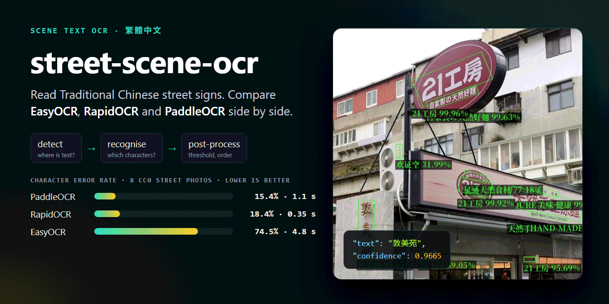
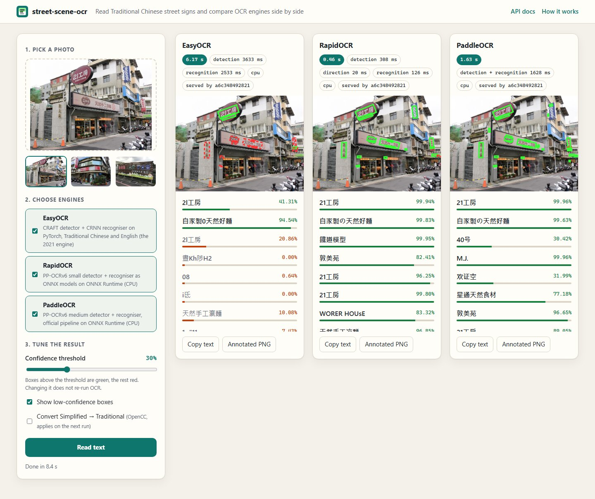
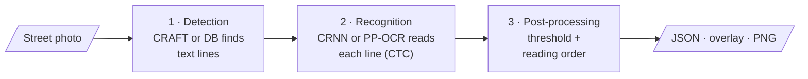
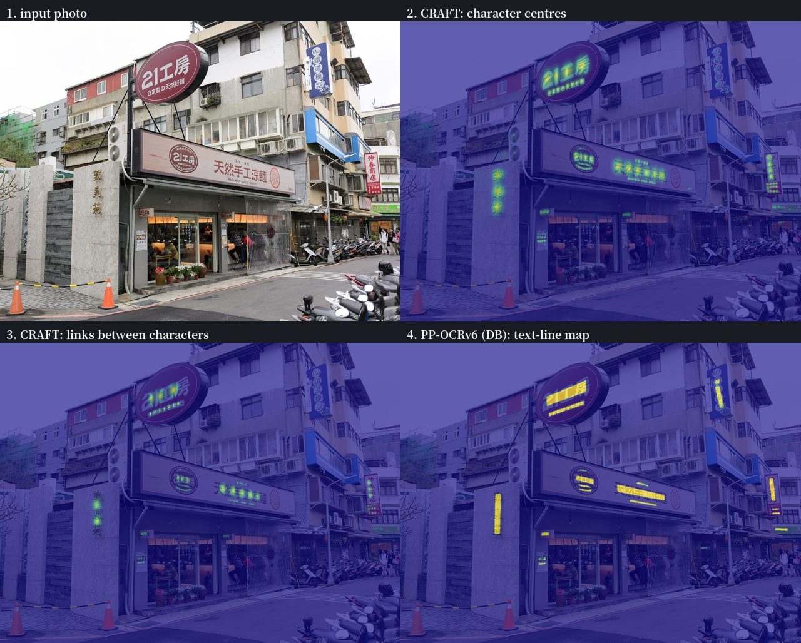

<p align="center">
  
</p>

# street-scene-ocr

[](https://github.com/NatLee/street-scene-ocr/actions/workflows/ci.yml)
[](LICENSE)


Read the text on Traditional Chinese street signs — shop names, phone numbers, vertical signboards — and see
how three OCR engines do it. Upload a photo on the web page or send it to the JSON API, and **EasyOCR**,
**RapidOCR** and **PaddleOCR** each draw the boxes they found and the text they read, with timings for every
step. The documentation walks through the pipeline (detection → recognition → post-processing) with real
model outputs, and a small benchmark with public-domain photos tells you which engine to pick.

這是一個街景中文字辨識的學習專案：上傳街景照片，三種 OCR 引擎並排比較找到的文字框、辨識結果與每個步驟的耗時。
文件用真實的模型輸出，一步步說明「偵測 → 辨識 → 後處理」，並附上用公眾領域照片做的小型評測。



## What is inside

- **A web page** to upload a photo (or pick a sample), choose engines, and move a confidence threshold that
  re-colours the boxes instantly. Each engine gets its own panel with its boxes, text, confidence and timing.
- **A JSON API** built with FastAPI, with interactive docs at `/docs`: boxes, text, confidence and per-stage
  timing for every region, or the annotated image as a PNG.
- **Three engines behind one interface.** Adding a fourth is one class ([how](docs/engines.md#adding-an-engine)).
- **A Docker set-up** with Traefik spreading requests over several containers, an HTTPS production mode and an
  optional GPU image.
- **Learning material**: [how scene-text OCR works](docs/pipeline.md), [which engine to choose](docs/engines.md)
  and [a benchmark you can re-run](eval/README.md).

## Quick start

With Docker (builds the image, downloads the models once, starts Traefik and two OCR containers):

```bash
git clone https://github.com/NatLee/street-scene-ocr.git
cd street-scene-ocr
docker compose up --build
```

Open <http://localhost:8080>, click a sample photo and press **Read text**. The first read of each engine
takes a few extra seconds while it loads its models.

Without Docker, with the lightest engine (Python 3.11 or newer):

```bash
pip install -e ".[rapidocr]"          # or ".[easyocr]", ".[paddleocr]", ".[easyocr,rapidocr,paddleocr]"
OCR_DEFAULT_ENGINE=rapidocr street-scene-ocr serve
```

Then open <http://localhost:8000>. The same install gives you a command line:

```bash
street-scene-ocr read eval/data/photos/noodle-shop-21.jpg --engine rapidocr --annotated out.png
```

## Use the API

```bash
curl -F file=@eval/data/photos/street-name-signs.jpg -F engine=rapidocr http://localhost:8080/api/ocr
```

```json
{
  "engine": "rapidocr",
  "device": "cpu",
  "width": 927,
  "height": 1400,
  "min_confidence": 0.3,
  "regions": [
    {
      "text": "富錦街",
      "confidence": 0.9873,
      "confident": true,
      "polygon": [[285, 393], [402, 376], [409, 425], [293, 442]],
      "bbox": [285, 376, 409, 442]
    },
    {
      "text": "三民路",
      "confidence": 0.9994,
      "confident": true,
      "polygon": [[469, 459], [594, 491], [582, 536], [457, 505]],
      "bbox": [457, 459, 594, 536]
    }
  ],
  "text": "富錦街
三民路",
  "to_traditional": false,
  "stages_ms": {"detection": 228, "direction": 4.4, "recognition": 15},
  "total_ms": 256.4,
  "served_by": "a6c348492821"
}
```

Other endpoints:

| Endpoint | What it returns |
|---|---|
| `POST /api/ocr` | JSON as above. Form fields: `file`, and optionally `engine`, `min_confidence` (0–1) and `to_traditional` (convert Simplified characters with OpenCC). |
| `POST /api/ocr/annotated` | The image as PNG with green (confident) and red (unsure) outlines and labels. Extra field: `show_unsure`. |
| `GET /api/engines` | Engines on this server, whether they are installed and loaded, and the defaults. |
| `GET /healthz` | `{"status": "ok"}`, for Docker and Traefik. |
| `GET /docs` | Interactive API documentation (Swagger UI). |

From Python:

```python
import requests

with open("eval/data/photos/sheng-chun-shop.jpg", "rb") as photo:
    answer = requests.post(
        "http://localhost:8080/api/ocr",
        files={"file": photo},
        data={"engine": "paddleocr", "min_confidence": 0.5},
    ).json()

for region in answer["regions"]:
    print(f"{region['confidence']:.0%}  {region['text']}")
```

Every response carries an `X-Served-By` header with the name of the container that answered, so you can
watch Traefik spread the requests.

## How it works



The engines do steps 1 and 2; step 3 is shared code, so every engine is treated the same. The full
explanation, with the detectors' actual heat maps and the recognisers' readings side by side, is in
[docs/pipeline.md](docs/pipeline.md).



## Which engine?

Measured on 8 CC0 street photos (70 lines of sign text) and 24 synthetic signs, 4 CPU cores, the engines'
default models. **CER** is the character error rate: lower is better.

| Engine | Photos: CER | Photos: lines exactly right | Synthetic: CER | Time per photo |
|---|---:|---:|---:|---:|
| **PaddleOCR** (PP-OCRv6 medium) | **15.4 %** (12.4 % with OpenCC) | 39 / 70 | 0.5 % | 1.1 s |
| **RapidOCR** (PP-OCRv6 small) | 18.4 % (15.7 % with OpenCC) | 37 / 70 | **0.0 %** | **0.35 s** |
| EasyOCR (CRAFT + CRNN, 2021) | 74.5 % | 8 / 70 | 14.7 % | 4.8 s |

In short: **RapidOCR** is the one to start with: nearly as accurate as PaddleOCR, about three times faster, no model
download. **PaddleOCR** reads a little more. **EasyOCR**, the 2021 choice, misses most real signs: it finds
few vertical and stylised signs, and its Traditional Chinese model cannot read the の in 二哥の店. Most of the
PP-OCR mistakes are Simplified forms of the right character (贺 for 賀, 凉 for 涼), which the optional OpenCC
conversion fixes.

Details, caveats and how to re-run it: [eval/README.md](eval/README.md). What each engine is and how to add
your own: [docs/engines.md](docs/engines.md).

## Deploy

- `docker compose up` — local demo, Traefik on port 8080 in front of two OCR containers
  (`OCR_REPLICAS=4` for more).
- `docker compose -f compose.yaml -f compose.prod.yaml up -d` — join an existing Traefik with HTTPS on your
  domain (`OCR_DOMAIN=…`), the set-up used in 2021.
- `docker compose -f compose.yaml -f compose.gpu.yaml up --build` — PyTorch CUDA image; EasyOCR runs on the GPU.

All settings (default engine, threshold, upload limit, model folder, device …) are environment variables,
listed in [docs/deploy.md](docs/deploy.md#settings) together with the deployment test plan.

## Project layout

```text
src/street_scene_ocr/
  engines/        one class per engine + the shared interface (base.py)
  service.py      loads engines on first use, runs the pipeline
  postprocess.py  confidence threshold, reading order
  render.py       draws boxes and labels (annotated PNG)
  evaluation.py   CER scoring used by the benchmark
  api.py          FastAPI app;  web/  the upload page
eval/             benchmark: photos, synthetic signs, labels, run.py, results/
docs/             pipeline, engines, deployment, history, images (+ figures.py, cover.html)
docker/           engine install script used by the Dockerfile
tests/            unit tests (fake engine) + a real-engine smoke test run in CI
```

## History

This started in 2021 as a take-home test for a job interview: build a scene-text recognition service for
Chinese and English street signs, with a Docker deployment plan. The original question, what the first
version did and its presentation are in [docs/history.md](docs/history.md). Every feature of the 2021 version
is still here.

## Licence

- Code: [Apache-2.0](LICENSE).
- Bundled font: Noto Serif CJK TC, [SIL Open Font License 1.1](src/street_scene_ocr/fonts/OFL.txt).
- Benchmark and sample photos: CC0 1.0 from Wikimedia Commons, authors listed in
  [eval/data/photos](eval/data/photos/README.md). Synthetic signs: generated by this project.
- The OCR engines and their models keep their own licences (all Apache-2.0 at the time of writing).
