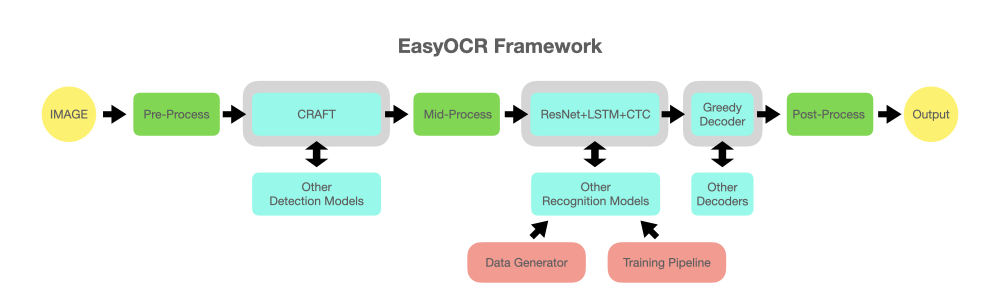
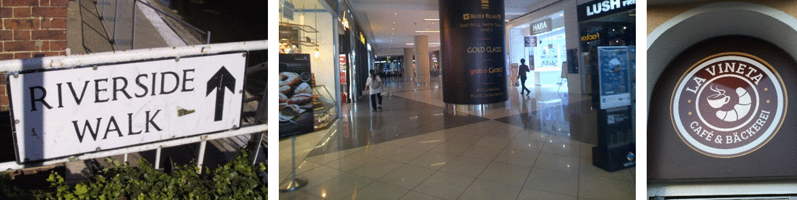
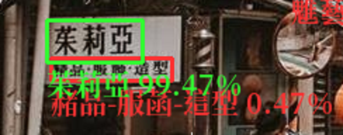

# 自然場景中文字辨識應用

> Author: NatLee

> Last update date: 2021/08/02

> Job: AI應用服務工程師

This was a take-home test for a job interview at a financial company.

## Question

- 自然場景中文字辨識應用(街景中的招牌等非固定格式中英文辨識)
- 自行搜尋網路上repo, 建置對應辨識服務，請以分階段建置服務
    - 準備docker部署規劃
    - 後續正式部署測試說明

## Introduction

本專案爲建立一個`自然場景中文字辨識應用(街景中的招牌等非固定格式中英文辨識)`的網站服務系統

後端採用Flask建成基本網站服務，使用者上傳圖片後使用OpenCV及EasyOCR來辨識文字並繪出bounding box及text於原圖上輸出至前端

Load balance的部分採用Traefik來進行docker的container自動分流

## OCR
- https://github.com/JaidedAI/EasyOCR

- Strcture of EasyOCR

There are serveral parts in the structure.
The most important TWO are `text detection` and `text recognition`.

### Text detection

CRAFT Algorithm
- https://github.com/clovaai/CRAFT-pytorch

PyTorch implementation for CRAFT text detector that effectively detect text area by exploring each character region and affinity between characters.

The bounding box of texts are obtained by simply finding minimum bounding rectangles on binary map after thresholding character region and affinity scores.

### Text recognition

CRNN: An End-to-End Trainable Neural Network for Image-based Sequence Recognition and Its Application to Scene Text Recognition
- https://arxiv.org/abs/1507.05717

Benchmark of text recognition model
- https://github.com/clovaai/deep-text-recognition-benchmark

As the figure, we can know that CRNN is not the best.

Although this model is not the best, its response time and parameters are the least.

In situations, there are lots of traffic and low response time are required. This architecture meets the requirements.

## Usage

- Python

    `python3 app.py`

- Docker(you need to run traefik at first for load balance)

    `docker-compose up`

## Display

When you upload an image, it will display the predicted result.

The accuracy is higher than 30%, it'll show with green bounding box.

There are one part of image as following.

The comparison with original image and result is shown as below.

