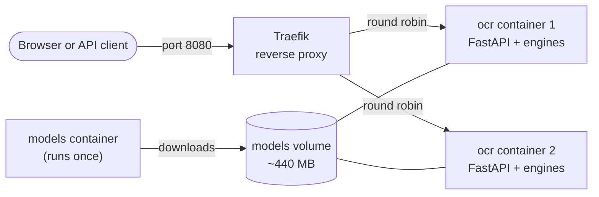

# Running it: Docker, Traefik, HTTPS and GPU

The question this project answered in 2021 asked for "a Docker deployment plan and how the production
deployment would be tested". This page is that plan, updated.



## Local demo with load balancing

```bash
docker compose up --build
```

- The page and the API are on <http://localhost:8080>, the Traefik dashboard on <http://localhost:8081>.
- The first start builds the image (about 3 GB with all three engines) and the one-off `models` container
  downloads the EasyOCR and PaddleOCR models (about 440 MB) into a named volume. Later starts reuse both.
- Two OCR containers start by default. Change that with `OCR_REPLICAS=4 docker compose up -d`, or scale a
  running stack with `docker compose up -d --scale ocr=4`.

See the load balancing happen: every response has an `X-Served-By` header naming the container that answered,
and the web page shows it as a badge on each result.

```bash
for i in 1 2 3 4; do curl -s -o /dev/null -D - http://localhost:8080/healthz | grep -i x-served-by; done
# x-served-by: 3f2a9c1d7b6e
# x-served-by: 8e41d0a2c5f9
# x-served-by: 3f2a9c1d7b6e
# x-served-by: 8e41d0a2c5f9
```

Why load balancing matters here: OCR is CPU-heavy and each engine reads one image at a time (a lock keeps two
requests from fighting over the same model). More containers means more images read at once. On one machine
that only helps while there are spare CPU cores; across machines it is how the service scales.

### Threads, CPU limits and replicas

Inference libraries start one worker thread per CPU core they can see, and inside a container they see the
whole host. Limit a container to 4 of 32 cores (`docker run --cpus 4`) and 32 threads fight over 4 cores: in
this project's first benchmark run, RapidOCR took 9.6 s per photo instead of 0.6 s, PaddleOCR 19 s instead of
2.5 s. The service therefore reads the container's CPU limit and tells every engine to use that many threads
(`OCR_THREADS` overrides it).

The same applies to replicas on one machine: two replicas without limits each use every core, so two requests
at once still share the CPUs. To give each replica its own cores, add a limit such as
`deploy: {resources: {limits: {cpus: "4"}}}` to the `ocr` service; the thread count follows automatically.

## Production: your own Traefik and HTTPS (the 2021 set-up)

In 2021 the containers joined a Traefik that was already running on the server, with a domain rule and a
Let's Encrypt certificate. `compose.prod.yaml` keeps exactly that:

```bash
OCR_DOMAIN=ocr.example.com docker compose -f compose.yaml -f compose.prod.yaml up -d
```

It assumes your Traefik is attached to an external Docker network called `web`, has an entrypoint called
`websecure` and a certificate resolver called `le` (the names used in 2021). The bundled Traefik is not
started in this mode.

How to test the production deployment:

1. `curl -fsS https://ocr.example.com/healthz` returns `{"status": "ok", ...}`: Traefik routes to a healthy
   container and the certificate is valid.
2. `curl -fsS https://ocr.example.com/api/engines` lists the engines with `"installed": true`.
3. Upload a known image and check the text:
   `curl -fsS -F file=@eval/data/synthetic/sign-00.jpg -F engine=rapidocr https://ocr.example.com/api/ocr`.
4. Repeat the health check a few times and check that `X-Served-By` changes between replicas.

The CI workflow runs steps 1, 3 and 4 against the local stack on every push.

## Choosing engines and image size

The image installs the engines named in the `ENGINES` build argument (all three by default):

| `ENGINES` | What gets installed | Approximate image size |
|---|---|---:|
| `"easyocr rapidocr paddleocr"` (default) | PyTorch CPU, ONNX Runtime, PaddleOCR's runtime, OpenGL libraries for its OpenCV build | 3.2 GB, plus 0.44 GB of models in the volume |
| `"rapidocr"` | ONNX Runtime only (models ship inside the package, no download) | 0.85 GB |

```bash
docker build --build-arg ENGINES="rapidocr" -t street-scene-ocr:rapid .
docker run --rm -p 8000:8000 -e OCR_DEFAULT_ENGINE=rapidocr street-scene-ocr:rapid
```

Two install quirks live in [`docker/install-engines.sh`](../docker/install-engines.sh) with a comment each:
PyTorch comes from the CPU-only package index (PyPI's default Linux build pulls several GB of CUDA
libraries), and PaddleOCR's runtime pins the desktop build of OpenCV, which needs the OpenGL system
libraries.

## GPU

```bash
docker compose -f compose.yaml -f compose.gpu.yaml up --build
```

This builds on the official PyTorch CUDA image and hands the NVIDIA GPU to the OCR containers (you need the
NVIDIA Container Toolkit). Only **EasyOCR** uses the GPU: it is the one engine built on PyTorch. RapidOCR and
PaddleOCR run on the CPU build of ONNX Runtime and are already fast there; the benchmark shows by how much.
The `device` field in every API response says where the engine actually ran.

Without Docker: install a CUDA build of PyTorch first, then `pip install -e ".[easyocr]"` and start with
`OCR_DEVICE=cuda` (fails loudly when no GPU is visible) or `OCR_DEVICE=auto` (uses the GPU when there is one).

## Settings

All settings are environment variables:

| Variable | Default | What it does |
|---|---|---|
| `OCR_DEFAULT_ENGINE` | `easyocr` | Engine used when a request does not name one (the 2021 engine). Falls back to the first installed engine. |
| `OCR_ENGINES` | every installed engine | Comma-separated list of engines to offer, e.g. `rapidocr,paddleocr`. |
| `OCR_DEVICE` | `cpu` | `cpu`, `cuda` or `auto`. Only affects EasyOCR. |
| `OCR_MIN_CONFIDENCE` | `0.3` | Default threshold for "confident" regions (green boxes). Requests can override it. |
| `OCR_TO_TRADITIONAL` | `false` | Convert Simplified characters in results to Traditional with OpenCC (see [post-processing](pipeline.md#3-post-processing-from-raw-guesses-to-a-usable-answer)). Requests can override it. |
| `OCR_MAX_UPLOAD_MB` | `16` | Largest upload accepted (the 2021 limit). |
| `OCR_MAX_IMAGE_SIDE` | `2560` | Longer photos are shrunk to this many pixels before OCR; boxes are scaled back. |
| `OCR_MODEL_DIR` | library defaults; `/models` in Docker | Where EasyOCR and PaddleOCR keep downloaded models (RapidOCR ships its models inside its package). |
| `OCR_THREADS` | CPUs this container may use | Threads each engine uses for one image. Detected from the container's CPU limit (cgroup v1 or v2) and CPU pinning. |
| `OCR_FONT_PATH` | bundled Noto Serif CJK TC | Font for the labels on annotated images. |
| `OCR_HOST`, `OCR_PORT` | `0.0.0.0`, `8000` | Where the server listens. |

Compose-only: `OCR_DOMAIN` (your domain, `compose.prod.yaml` only), `OCR_REPLICAS` (default 2),
`OCR_HTTP_PORT` (default 8080), `TRAEFIK_DASHBOARD_PORT` (default 8081).
