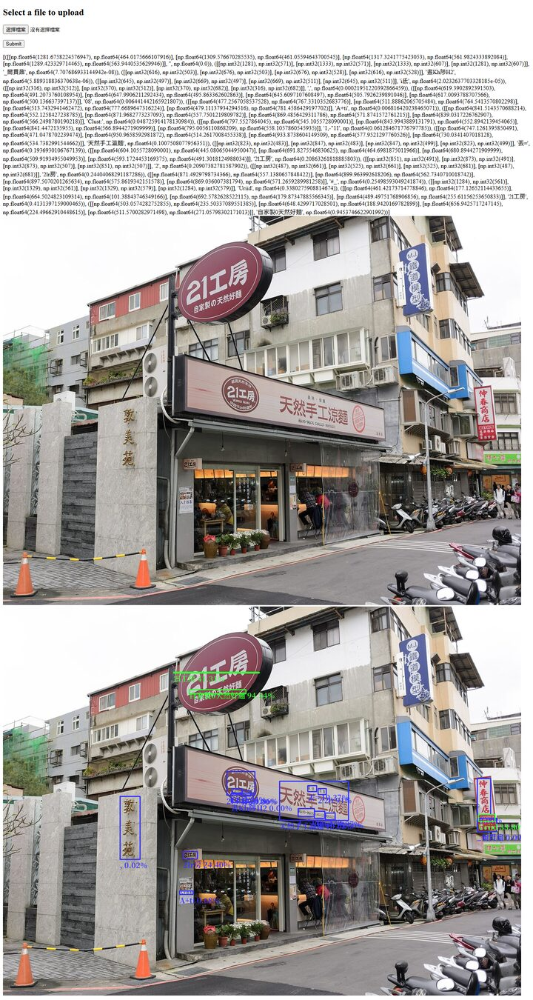

# Where this project came from

This repository started in August 2021 as a take-home test for an 「AI應用服務工程師」(AI application
engineer) job interview at a financial company. In 2026 it was rebuilt into a learning project: same idea,
current tools, an honest benchmark and documentation that explains every step.

## The original question (2021, verbatim)

> - 自然場景中文字辨識應用(街景中的招牌等非固定格式中英文辨識)
> - 自行搜尋網路上repo, 建置對應辨識服務，請以分階段建置服務
>     - 準備docker部署規劃
>     - 後續正式部署測試說明

In English: build a text-recognition service for natural scenes — Chinese and English on street signs and other
free-form text. Find suitable open-source code, build the service in stages, prepare a Docker deployment plan
and explain how the production deployment would be tested.

## What the 2021 answer was

A single Flask app (`app.py`, about 120 lines):

1. An upload form accepted a png, jpg or jpeg image up to 16 MB.
2. [EasyOCR](https://github.com/JaidedAI/EasyOCR) read it with the Traditional Chinese and English models.
3. OpenCV drew a rectangle around each piece of text, green when the confidence was above 30 %, and Pillow
   wrote the text and its confidence under the box with the Noto CJK font.
4. The page showed the raw result list, the original image and the annotated image.
5. A Dockerfile packaged it, and a docker-compose file attached it to an existing Traefik reverse proxy with a
   domain rule and Let's Encrypt HTTPS, so several containers could share the traffic.

Every one of those features is still here, see the checklist at the end. This is what the page looked like,
running the 2021 code unchanged (Flask, EasyOCR) on one of the CC0 benchmark photos:



## The 2021 presentation, in short

The answer came with a 12-slide deck. The deck itself is no longer in the repository (its title slide carried
the company's logo), but this is what it said:

1. **Title** — 自然場景中文字辨識應用 (scene text recognition), Nat Lee, 2021-08-02.
2. **Stages** — question definition, introduction, OCR (text detection and recognition), result, load balance.
3. **Question definition** — recognise free-form Chinese and English on street signs; find open-source code
   and build a service; deliver it in stages with a Docker deployment plan and a production test plan.
4. **Introduction** — a website where users upload a picture; the backend runs OpenCV and EasyOCR, draws the
   bounding boxes and the text on the picture; Traefik spreads the requests over Docker containers.
5. **OCR** — section title.
6. **EasyOCR's structure** — several parts, the two that matter being *text detection* and *text recognition*.
7. **Text detection: CRAFT** — CRAFT looks for each character and for the "affinity" (link) between
   neighbouring characters; the boxes are the minimum bounding rectangles of the thresholded maps.
8. **Text recognition: CRNN** — in the deep-text-recognition-benchmark comparison CRNN is not the most accurate
   model, but it is the fastest and the smallest, which suits a service with a lot of traffic and a need for low
   latency.
9. **Result** — after an upload the page shows the prediction; boxes above 30 % confidence are green.
10. **Result** — the full annotated street photo.
11. **Load balance** — Traefik in front, routing by domain to Docker containers:

    ```mermaid
    flowchart LR
        user([Browser]) --> traefik[Traefik]
        traefik -- domain01.com --> c1[Container]
        traefik -- domain02.com --> c2[Container]
    ```

12. **Thank you** — contact details.

Slides 6 to 8 are now [docs/pipeline.md](pipeline.md), with diagrams and real outputs instead of pictures
copied from papers. Slide 8's argument — pick the model that is fast enough, not the one at the top of the
leaderboard — is now something you can measure yourself: see [the benchmark](../eval/README.md).

## What changed in 2026

| 2021 | 2026 |
|---|---|
| Flask page that re-renders on every upload | FastAPI service with a JSON API, OpenAPI docs at `/docs` and a web page that draws the boxes in the browser |
| EasyOCR only | EasyOCR, RapidOCR (PP-OCRv6 small on ONNX Runtime) and PaddleOCR (PP-OCRv6 medium), one class each behind one interface |
| Fixed 30 % threshold | Same default, adjustable per request and live on the page |
| Low-confidence boxes drawn blue by accident (blue-green-red numbers on a red-green-blue image) | Red, as the code comment intended |
| `python:3.8-slim-buster`, unpinned PyTorch from PyPI (several GB of CUDA libraries) | `python:3.12-slim` with the CPU build of PyTorch; a GPU variant on the PyTorch CUDA image |
| Needed a Traefik already running on the host | `docker compose up` brings its own Traefik for a local demo; `compose.prod.yaml` keeps the 2021 external-Traefik + HTTPS set-up |
| No tests | Unit tests, a real-engine smoke test and a Traefik round-robin check in CI |
| A street photo of unknown origin as the example | CC0 photos from Wikimedia Commons and synthetic signs, each with its source recorded |

## Feature checklist

- [x] Upload png, jpg or jpeg up to 16 MB and get the annotated image back — the web page, `/api/ocr/annotated`
      and `street-scene-ocr read --annotated`.
- [x] Green boxes above 30 % confidence, labels with the text and the percentage in the Noto CJK font
      (`render.py`, same label format `水果行 99.87%`).
- [x] EasyOCR with Traditional Chinese and English, still the default engine.
- [x] Docker image (`Dockerfile`).
- [x] Several containers behind Traefik (`compose.yaml`), and the domain + Let's Encrypt set-up
      (`compose.prod.yaml`).
- [x] The explanation of detection (CRAFT) and recognition (CRNN) and the speed/accuracy trade-off
      ([docs/pipeline.md](pipeline.md)).
- [x] The presentation's content (this page).
