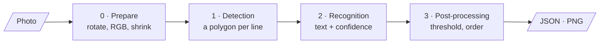
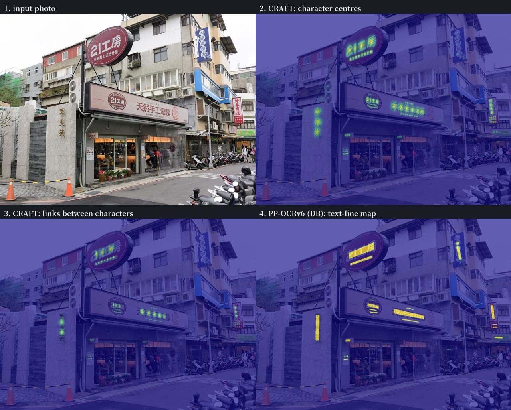
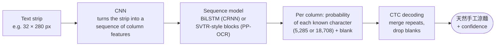
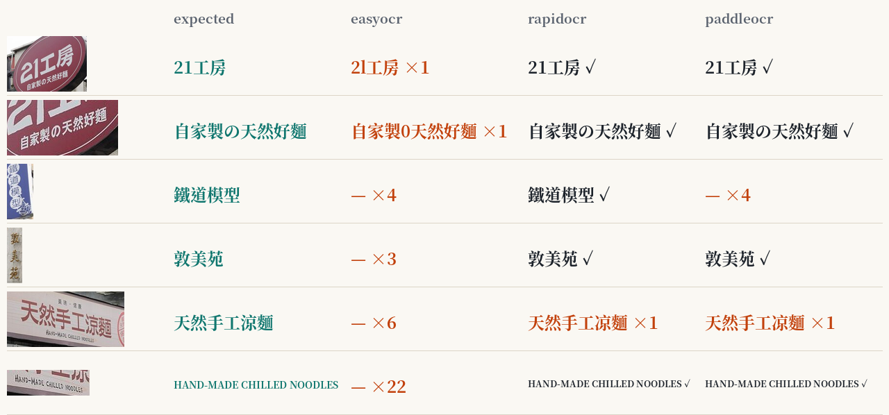
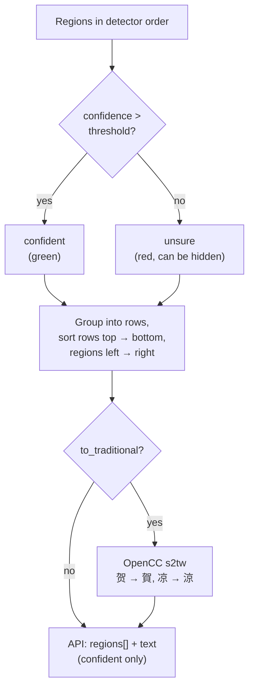
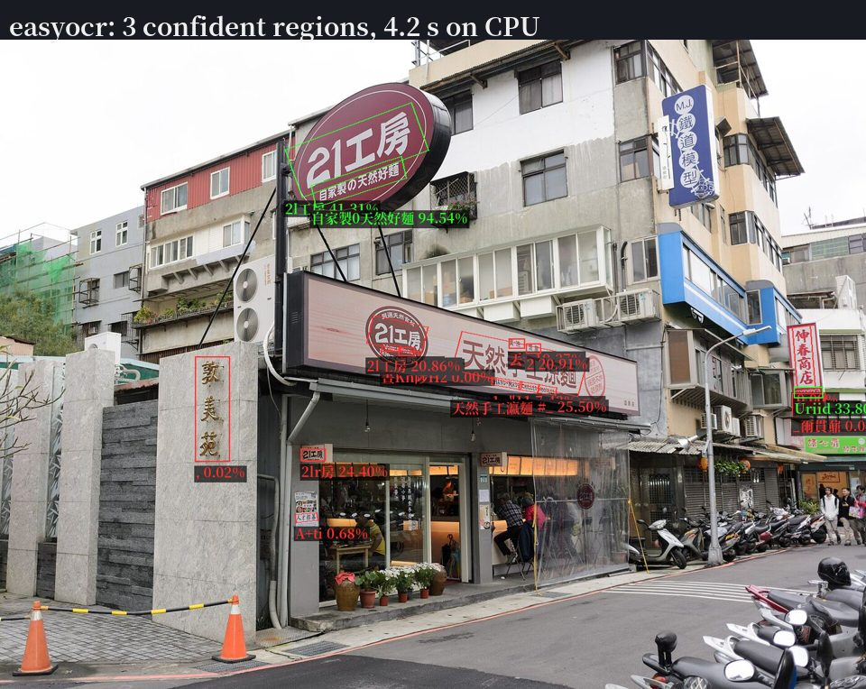
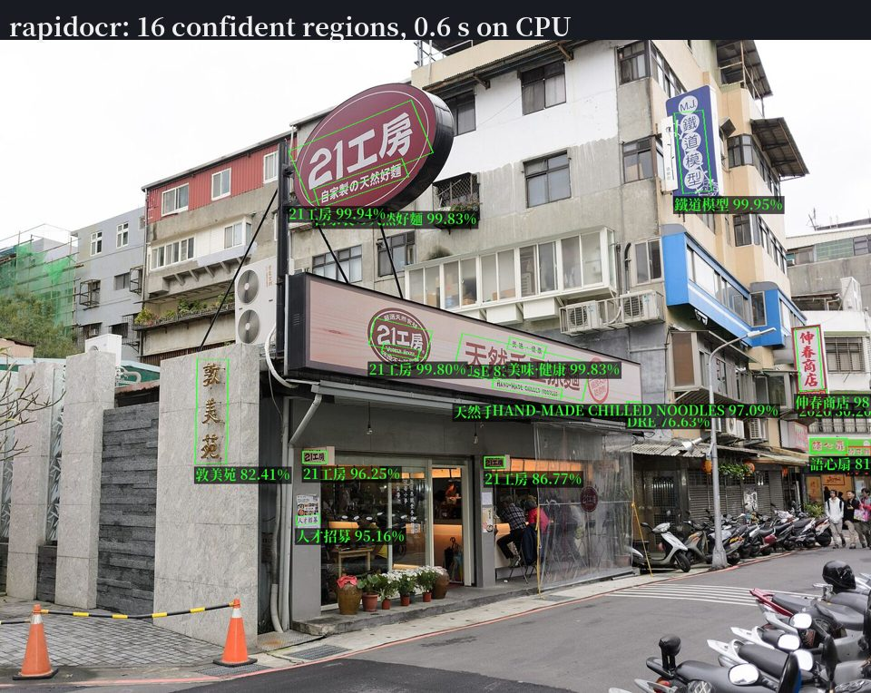
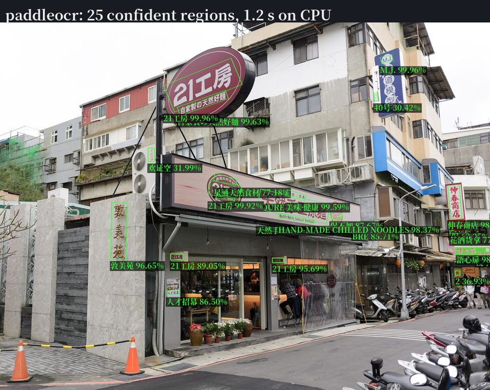

# How scene-text OCR works, step by step

Reading a street sign is three jobs in a row: **find** where the text is, **read** each piece, then **clean
up** the result. Every engine in this project follows that shape, and so does the code: the engines do the
first two steps, `postprocess.py` does the third, the same way for all of them.

All pictures on this page are real outputs, made by [`docs/figures.py`](figures.py) from a CC0 photo of a
noodle shop in Taipei (photo by 玄史生, see [eval/data/photos](../eval/data/photos/README.md)).

## 0. Preparing the image

Before any model runs, `imaging.py` does three boring but important things:

- **Apply the EXIF rotation.** Phones save photos sideways and add a flag saying "turn me 90°". Ignore it and
  every portrait photo arrives lying on its side, which no detector handles well.
- **Convert to RGB.** PNGs can have transparency or a palette; the models want three colour channels.
- **Shrink very large photos** so the longer side is at most 2560 px (`OCR_MAX_IMAGE_SIDE`). A 12-megapixel
  photo costs four times the work of a 3-megapixel one and rarely reads better. The boxes are scaled back to
  the original size afterwards, so you never notice.

## 1. Detection: where is the text?

The detector looks at the whole image and outputs a **map**: for every pixel, how likely is it to be text?
Turning that map into boxes is simple image processing: threshold it, find the connected blobs, put a
polygon around each blob. The two families used here differ in *what* the map describes.

**CRAFT** (used by EasyOCR, [Baek et al., CVPR 2019](https://arxiv.org/abs/1904.01941)) predicts two maps.
Panel 2 lights up at the **centre of every character**; panel 3 lights up in the **gaps between characters
that belong together**. Characters joined by links become one word or line. This is why CRAFT copes with
curved or widely spaced lettering: it reasons about characters, not about whole lines.

**DB, Differentiable Binarization** (the detector design of every PP-OCR version, including the PP-OCRv6
models used by RapidOCR and PaddleOCR, [Liao et al., AAAI 2020](https://arxiv.org/abs/1911.08947)) predicts
one map of **shrunken text lines** (panel 4): each line shows up as a solid bar slightly thinner than the real
text, so that neighbouring lines do not touch. After thresholding, each bar is grown back by a fixed ratio
(`unclip_ratio`, 1.6 in RapidOCR) to get the final polygon. One map, one threshold, very fast.

Things to notice in the panels:

- Both detectors light up the same places: the oval sign, the long shop sign, the vertical 敦美苑 on the stone
  pillar, the red 伸春商店 sign on the right and the small notices by the door.
- In panel 2, every character of 天然手工涼麵 is its own blob. Panel 3 lights up between them, and that is what
  makes the six blobs one line.
- Panel 4 is already a set of bars, one per line, slightly thinner than the text: the big line and the English
  line under it are two separate bars even though they touch. That is the "shrink" in DB, and it is a large part
  of why the PP-OCR detectors are fast: no character-level reasoning is needed afterwards.

## 2. Recognition: which characters?

Each detected polygon is cut out and warped into a straight, horizontal strip of fixed height (tall vertical
strips are turned 90° first, which is how vertical Chinese signs get read). The recogniser then reads the
strip from left to right:

- **CRNN** ([Shi et al., 2015](https://arxiv.org/abs/1507.05717)) is EasyOCR's recogniser: convolutional
  layers, a bidirectional LSTM that looks at the columns before and after, and **CTC** decoding.
- **CTC** (connectionist temporal classification) is the trick that makes this trainable without marking where
  each character starts and ends. The network outputs a guess per column, e.g. `天 天 - 然 - - 手 手 工 …`;
  CTC merges the repeats and removes the blanks (`-`) to get `天然手工…`.
- The **confidence** reported by the engines is derived from those per-column probabilities. It says how sure
  the model was about its own reading, not whether the reading is right. A model can be 99 % sure of a wrong
  character it has never been taught the difference for.
- The **PP-OCR recognisers** (RapidOCR, PaddleOCR) keep CTC but replace the LSTM with lighter convolution and
  attention blocks ([SVTR, Du et al. 2022](https://arxiv.org/abs/2205.00159), used since PP-OCRv3). The PP-OCRv6
  small and medium models read 50 languages with one model, Simplified and Traditional Chinese included, so a
  sign that mixes 中文, English and の is read in one pass.

Here is what the three engines read in some of the photo's lines (confident results only):

## 3. Post-processing: from raw guesses to a usable answer

Engines hand back every guess they made, in whatever order the detector found them. Small, engine-neutral
steps in [`postprocess.py`](../src/street_scene_ocr/postprocess.py) make that useful:

1. **Confidence threshold.** Regions above the threshold (30 % by default, as in 2021) are "confident" and
   drawn green; the rest are drawn red. Nothing is thrown away, so you can see what a stricter threshold would
   cost you. On the web page the slider re-colours the boxes without running OCR again.
2. **Reading order.** Regions are grouped into rows (two regions share a row when they overlap vertically by at
   least half of the smaller height) and each row is read left to right. That is how people scan a street, and
   it makes the joined `text` field in the API readable.
3. **Script conversion (optional).** The PP-OCRv6 models read Simplified and Traditional Chinese with one
   network, and on Taiwanese signs they regularly answer with the Simplified form: 贺 for 賀, 鲜 for 鮮,
   凉 for 涼, 锦 for 錦, 宾馆 for 賓館. [OpenCC](https://github.com/BYVoid/OpenCC) (`s2tw`, character by
   character, Taiwan's standard forms) turns those back. It is off by default because it also changes
   characters that were right: 台 is standard Traditional, but OpenCC prefers 臺, and 里 (village) becomes 裡.
   Switch it on per request (`to_traditional=true`), with `OCR_TO_TRADITIONAL=true`, or with the checkbox on
   the page.

Is the conversion worth it? On the benchmark photos it lowers the character error rate of RapidOCR from 18.4 %
to 15.7 % and of PaddleOCR from 15.4 % to 12.4 %, and leaves the synthetic signs unchanged. The fixes outnumber
the breakages
because the photos contain far more 賀, 鮮, 涼 than 台 or 里. On your own data, measure before you switch it
on: the benchmark scores both versions from the same engine output.

More ideas to try, each one a small function in the same file:

- **Dictionary correction.** Street signs repeat a small vocabulary (店, 行, 館, 麵, 專線 …); snapping
  low-confidence readings to known words is a classic trick.
- **Merging lines into blocks**, e.g. a phone number under its 外送專線 label.
- **A smarter conversion** that only touches characters which are not valid Traditional characters on their
  own, so 台 and 里 stay as they are.

## Putting it together: one photo, three engines

The same photo through each engine, drawn by the service's own `annotate()` (the "Annotated PNG" button on the
web page):

| EasyOCR (CRAFT + CRNN) | RapidOCR (PP-OCRv6 small) | PaddleOCR (PP-OCRv6 medium) |
|---|---|---|
|  |  |  |

How they compare on more than one photo, with numbers: [the benchmark](../eval/README.md). Which engine to pick
and why: [engines.md](engines.md).
